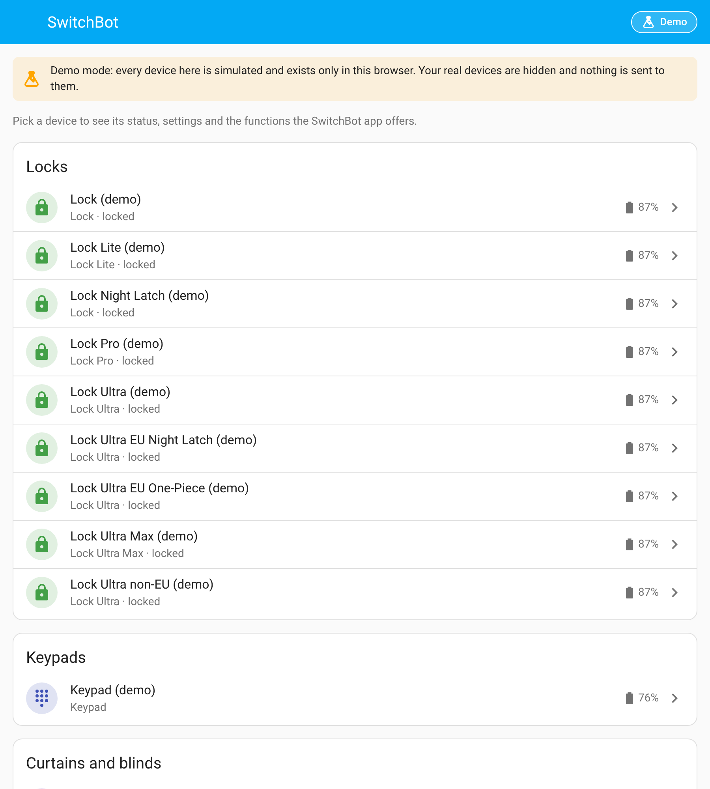
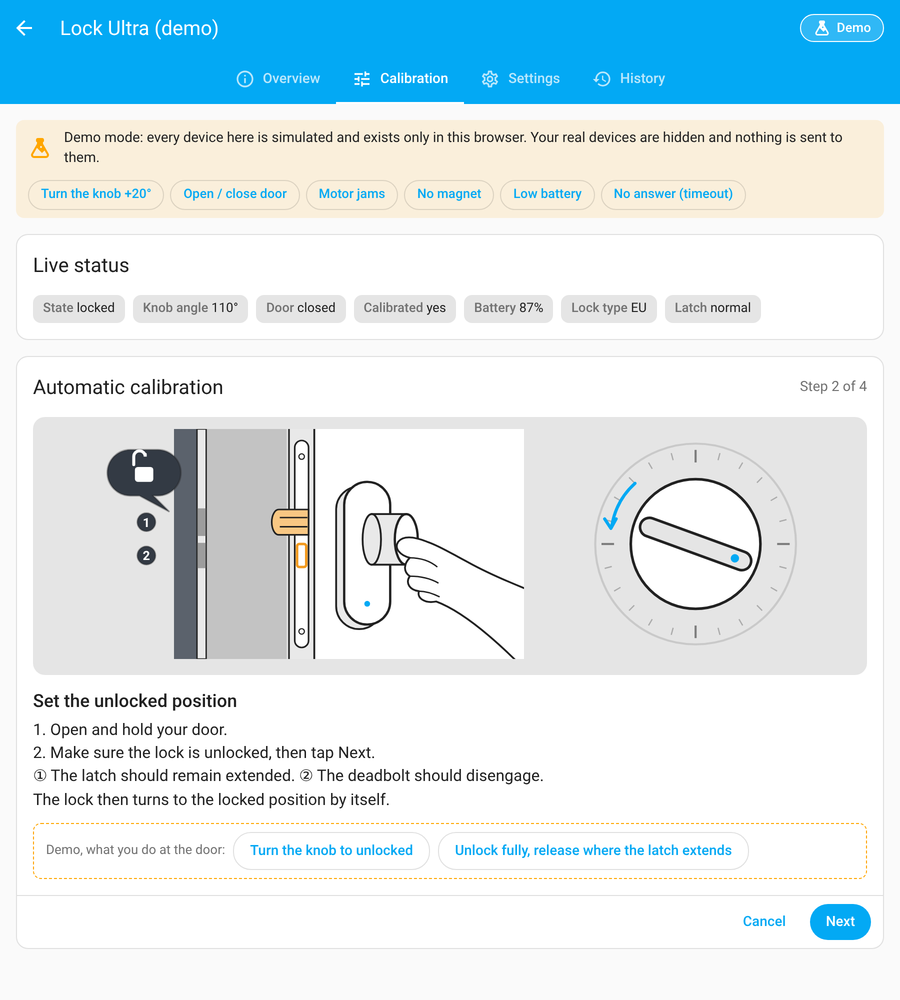
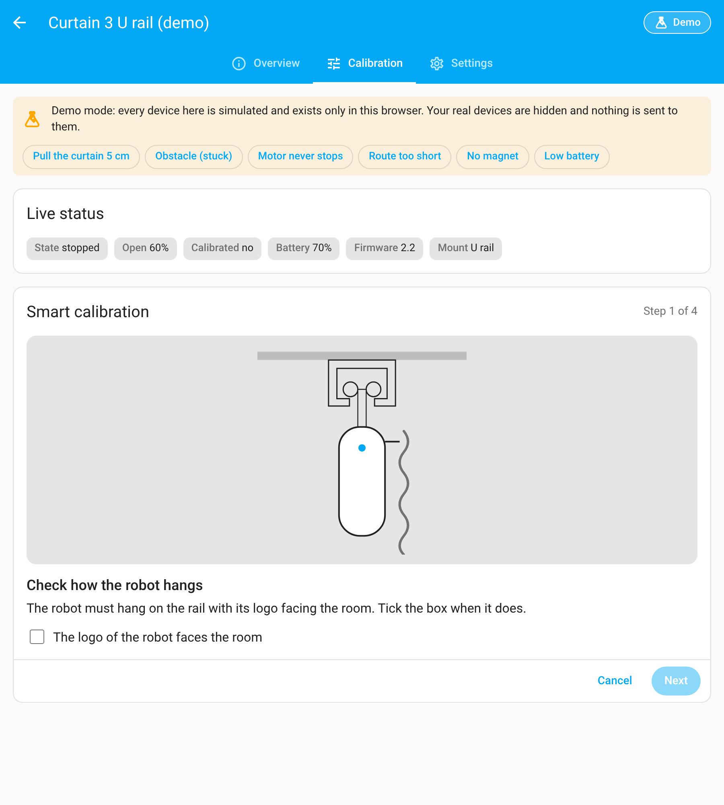
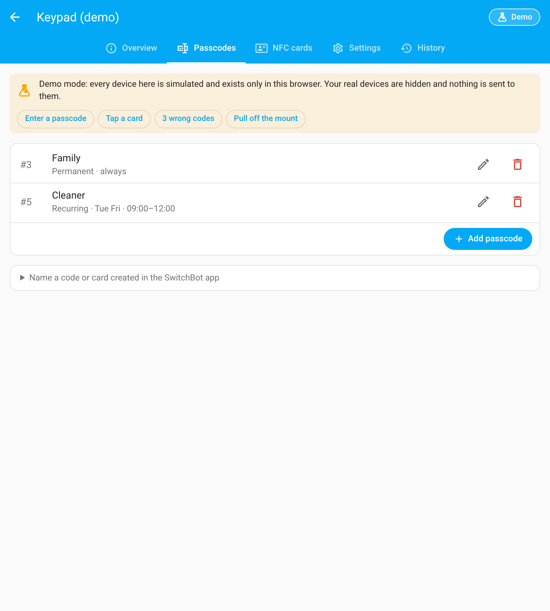
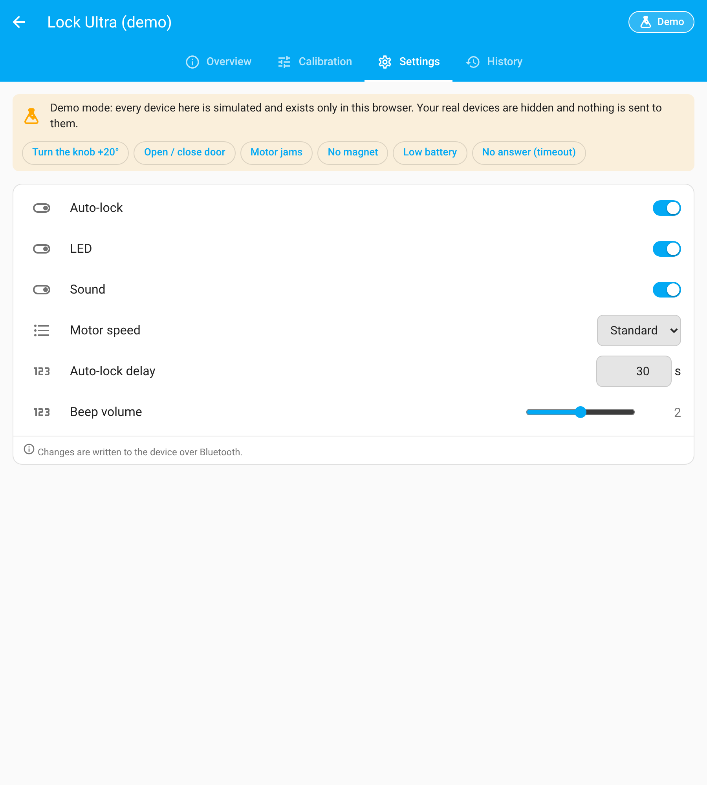
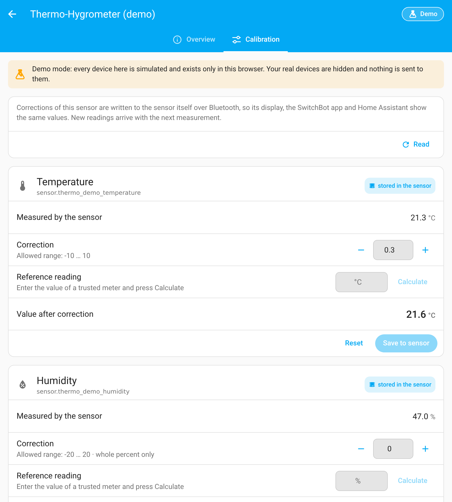

<p align="center">
  
</p>

<p align="center">
  <b>SwitchBot devices in Home Assistant, locally over Bluetooth, with the settings and wizards of the SwitchBot app.</b>
</p>

<p align="center">
  <b>English</b> · <a href="README.pl.md">Polski</a>
</p>

---

**SwitchBot BLE (extended)** (domain `ha_switchbot_ble`) is a standalone Bluetooth integration for SwitchBot devices. It supports 71 models: sensors, locks and keypads, curtains and shades, plugs and relays, lights, air purifiers, fans, humidifiers, radiator thermostats, hubs and robot vacuums.

Compared with the built-in SwitchBot integration it adds:

- **device settings** from the SwitchBot app as Home Assistant entities (sounds, LEDs, auto-lock, motion modes, child lock, timers…),
- a **SwitchBot panel** in the sidebar: overview, settings, sensor calibration, history, PIN codes and NFC cards,
- **calibration wizards** for locks, curtains, roller shades and Blind Tilt, step by step as in the app,
- its **own BLE library** (`sbble`), written from scratch from the SwitchBot app 10.10 protocol, with no external Python requirements.

Everything runs locally. The SwitchBot cloud is used only once, when an encrypted device is added, to fetch its key. The key can also be entered by hand.

> This integration is not affiliated with SwitchBot (Wonderlabs, Inc.). Product names belong to their owners.

## Requirements

- Home Assistant **2026.11** or newer.
- Bluetooth in Home Assistant: a local adapter or a Bluetooth proxy (ESPHome, Shelly). Sensors also work through passive proxies. Locks, keypads, curtains and other controlled devices need a proxy that can connect (*active*).

## Installation

<!-- ha-marketplace:exclude-start -->
[](https://my.home-assistant.io/redirect/marketplace_repository/?owner=KifKick&repository=ha-switchbot-ble&category=integration)

Or by hand: *Settings → Marketplace* → ⋮ menu → *Add from link* → `https://github.com/KifKick/ha-switchbot-ble`, category *Integration*. Adding a custom repository needs a GitHub account linked in the Marketplace. Install **SwitchBot BLE (extended)** and restart Home Assistant.
<!-- ha-marketplace:exclude-end -->

After installing and restarting, add the integration:

[](https://my.home-assistant.io/redirect/config_flow_start/?domain=ha_switchbot_ble)

Or by hand: *Settings → Devices & services → Add integration → SwitchBot BLE (extended)*.

## Adding devices

Devices in Bluetooth range show up as *Discovered*. Each device is its own config entry.

The setup wizard offers:

| Option | When |
|---|---|
| **Sign in with SwitchBot (OAuth, recommended)** | You sign in on SwitchBot's page and come back to Home Assistant through [My Home Assistant](https://my.home-assistant.io/). Accounts created with Google or Apple work too. It uses the public OAuth client SwitchBot registered for Home Assistant; a “SwitchBot” entry appears under *Application credentials*. |
| **Sign in with e-mail and password** | A SwitchBot account with a password. |
| **Continue without signing in** | Pick the device from the discovered ones. |
| **Take over from the built-in SwitchBot integration** | Moves a device set up in the built-in integration (see below). |

Signing in fetches the device list and models from the account, which helps to recognise devices seen only through passive proxies. Encrypted devices (locks, keypads, air purifiers, Curtain Track 4…) need an encryption key: the integration fetches it from the account or takes it typed in (key and key ID). **Neither the token nor the password is stored**; only the device key is kept in Home Assistant.

### Moving from the built-in integration

**Take over from the built-in SwitchBot integration** moves the device together with its entities: `entity_id`s, history, statistics and automations stay as they are, and the built-in entry is removed. The built-in integration will keep offering these devices as discovered; click *Ignore* on them once.

### Options

*Settings → Devices & services → SwitchBot BLE (extended) → Configure*:

- **Retry count** for Bluetooth commands,
- **Curtain motion mode** (curtains),
- **Force Nightlatch operation mode** (locks).

## Supported devices

| Family | Models | Added over the built-in integration |
|---|---|---|
| Thermo-hygrometers | Meter, Meter Plus, Meter Pro, Meter Pro CO2, Indoor/Outdoor Thermo-Hygrometer, Weather Station | reading correction in the panel: an offset in Home Assistant or a calibration stored in the sensor (Indoor/Outdoor Thermo-Hygrometer) |
| Sensors | Contact Sensor, Motion Sensor, Presence Sensor, Water Leak Detector | LED, detection range, alarm modes and volume |
| Locks | Lock, Lock Lite, Lock Pro, Lock Pro (Wi-Fi), Lock Ultra, Lock Ultra Max, Lock Vision, Lock Vision Pro | extended state (batteries, angle, alarms, night mode), settings (LED, sound, auto-lock, button, motor speed, volume, language…), operation history as an event entity, calibration wizard in the panel |
| Keypads | Keypad, Keypad Touch, Keypad Vision, Keypad Vision Pro | alarms and lockouts, settings, history with code names, PIN codes and NFC cards in the panel |
| Curtains and shades | Curtain, Curtain 3 (U-rail, I-rail, rod), Curtain Track 4, Roller Shade, Blind Tilt | movement as in the app, motion modes (performance, QuietDrift, silent), live direction, Touch & Go, charging and solar panel, alarms, mounting type, roll direction, slat layout; calibration and travel-adjustment wizards in the panel |
| Switches and plugs | Bot, Plug Mini (EU, US, JP), Relay Switch 1, Relay Switch 1PM, Relay Switch 2PM, Garage Door Opener | Plug Mini (EU): LED and power-on state |
| Lights | Color Bulb, Light Strip, Strip Light 3, Ceiling Light, Ceiling Light Pro, Floor Lamp, Candle Warmer Lamp, RGBICWW Strip Light, RGBICWW Floor Lamp, RGBICWW Light Bars, Permanent Outdoor Light, RGBIC Neon Rope Light, RGBIC Neon Wire Rope Light | — |
| Climate | Smart Radiator Thermostat, Climate Panel | thermostat: mode temperatures, calibration, quick heating, open-window detection, valve, faults |
| Air | Air Purifier (US, JP), Air Purifier Table (US, JP), Circulator Fan, Circulator Fan Pro, Standing Fan, Humidifier, Evaporative Humidifier | beep, sleep timer, child lock, display, fault sensors, night mode… |
| Hubs and remotes | Hub 2, Hub 3, Hub Mini (Matter), Remote, Universal Remote | — |
| Robot vacuums | K10+, K10+ Pro, K10+ Pro Combo, K11+, K20, S10, S20 | — |

Settings are in the *Configuration* entity category, technical state in *Diagnostic*. Device settings are read after start-up and every 6 hours; changes are written to the device right away.

Protocol notes per device (frames, bytes, calibration steps) are in [docs/](docs/).

## SwitchBot panel

A **SwitchBot** item in the sidebar, visible to administrators. Pick a device, then a tab:

| Tab | For | What it does |
|---|---|---|
| **Overview** | all devices | controls, state and diagnostics |
| **Settings** | all devices | the configuration entities in one place; changes are written to the device |
| **Calibration** | thermo-hygrometers | an offset in Home Assistant or a calibration stored in the sensor |
| **Calibration** | locks, curtains, shades, Blind Tilt | a wizard with pictures of the given model, with the same steps and checks as the app |
| **Passcodes** / **NFC cards** | keypads | codes and cards are stored in the keypad; Home Assistant keeps only their names |
| **History** | locks, keypads | who opened or locked, with what and when |

The **Demo** switch shows simulated devices of every kind, wizards included. Nothing is sent to real devices then, so a wizard can be walked through safely before a real calibration.

Screenshots from the demo mode (English UI).

<table>
  <tr>
    <td width="50%"><br><sub>Device list</sub></td>
    <td width="50%"><br><sub>Lock calibration wizard</sub></td>
  </tr>
  <tr>
    <td width="50%"><br><sub>Curtain 3 calibration wizard</sub></td>
    <td width="50%"><br><sub>Keypad passcodes</sub></td>
  </tr>
  <tr>
    <td width="50%"><br><sub>Lock settings</sub></td>
    <td width="50%"><br><sub>Sensor calibration</sub></td>
  </tr>
</table>

## Actions

| Action | Description |
|---|---|
| `ha_switchbot_ble.add_password` | Adds a PIN code to a Keypad Vision / Keypad Vision Pro (fields: `device_id`, `password`). |

## Troubleshooting

- **The device is not discovered**: check in *Settings → Devices & services → Bluetooth* that an adapter or proxy sees it. Controlled devices need an adapter or proxy that can connect.
- **Commands sometimes fail**: raise *Retry count* in the options or move a proxy closer to the device.
- **Logs**: *Enable debug logging* on the integration page, or in `configuration.yaml`:

  ```yaml
  logger:
    logs:
      custom_components.ha_switchbot_ble: debug
  ```

- **Diagnostics**: *Download diagnostics* on the device page. Encryption keys are redacted.

Bugs and ideas: [Issues](https://github.com/KifKick/ha-switchbot-ble/issues). Code layout and tests: [CONTRIBUTING.md](CONTRIBUTING.md).

## License

[MIT](LICENSE).
