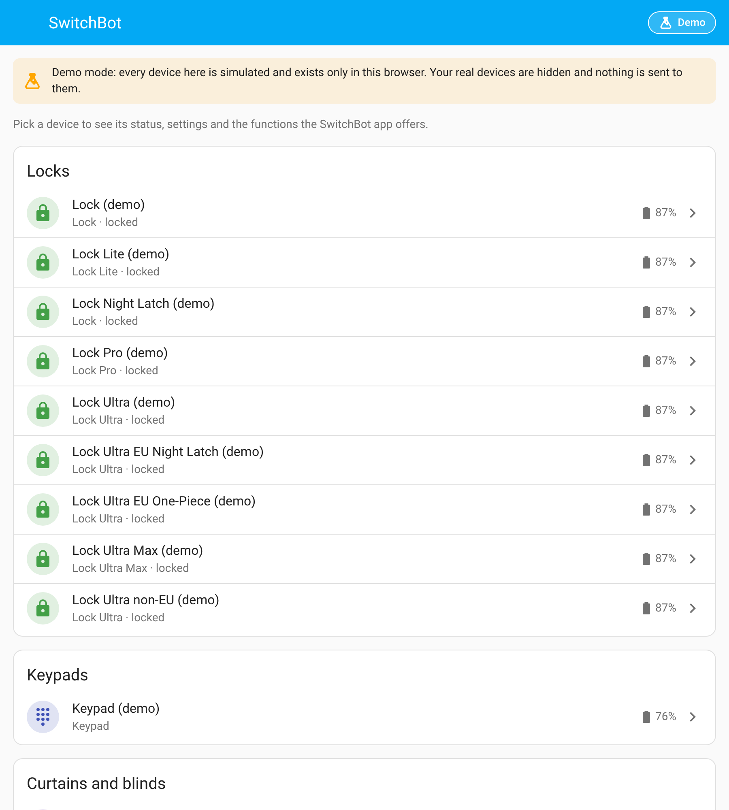
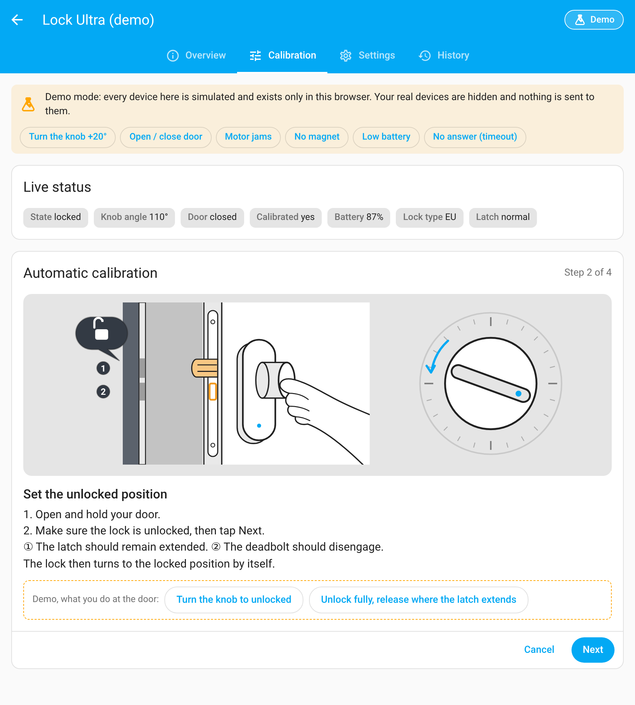
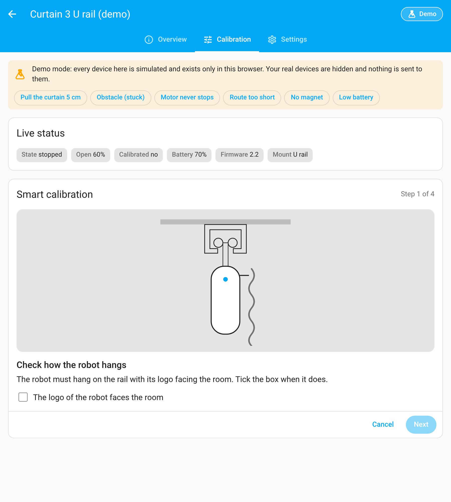
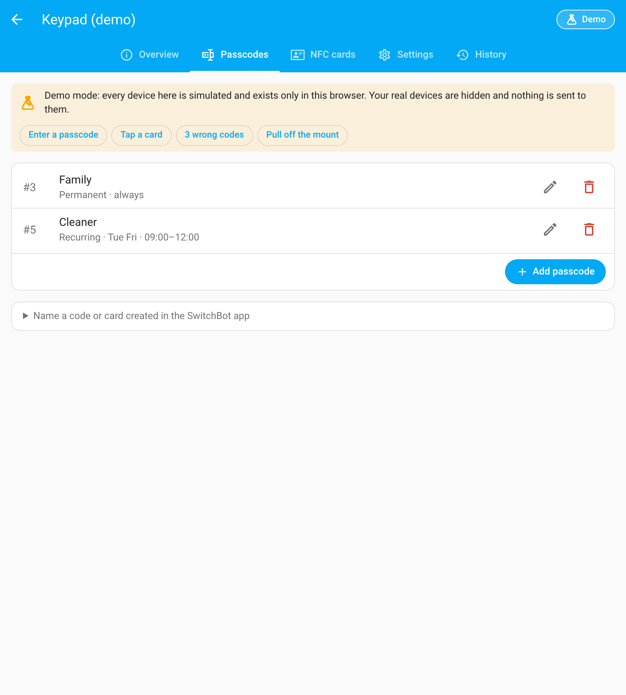
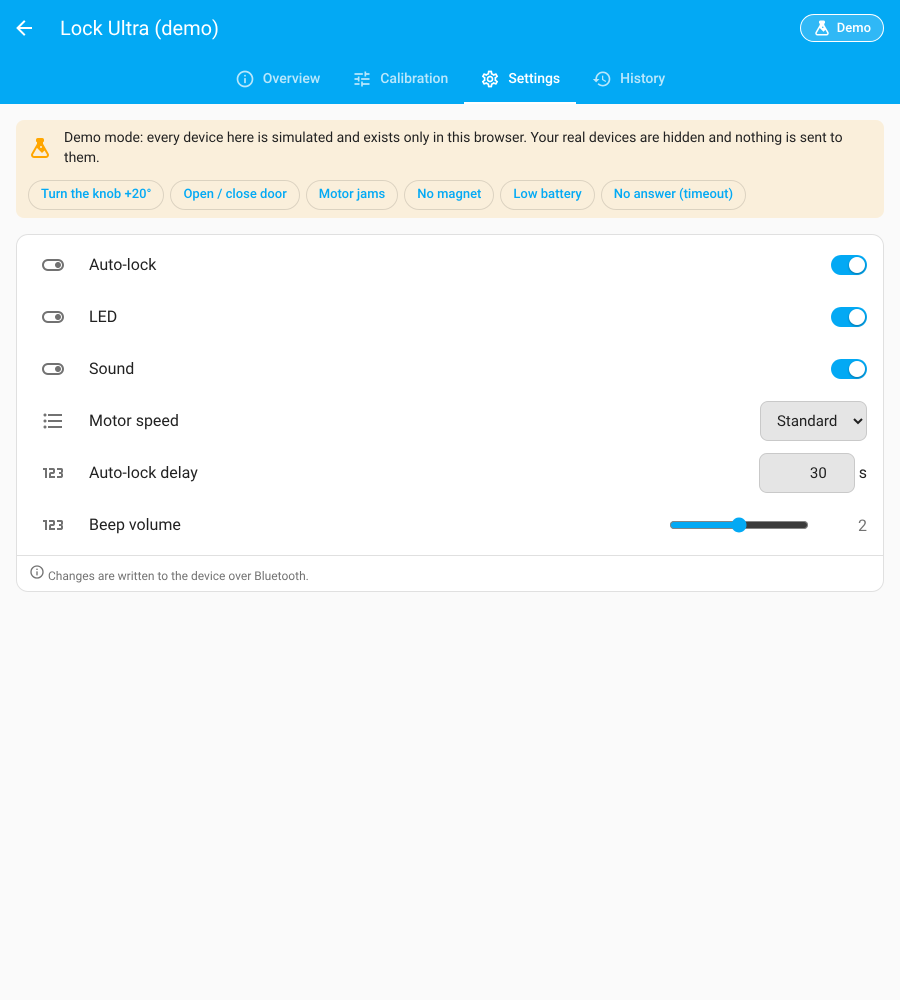
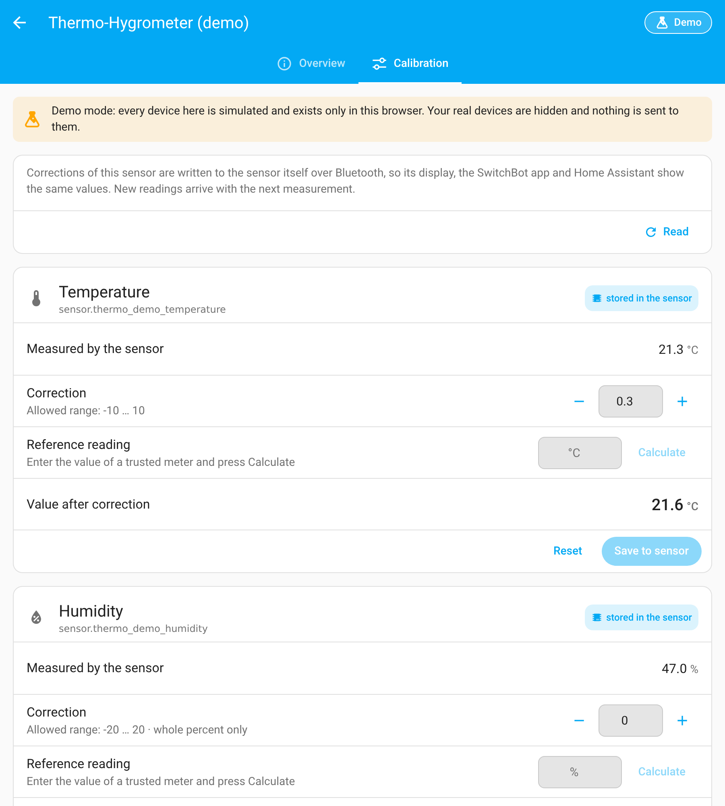

<p align="center">
  <picture>
    <source media="(prefers-color-scheme: dark)" srcset="custom_components/ha_switchbot_ble/brand/dark_logo.png">
    
  </picture>
</p>

<p align="center">
  <b>Urządzenia SwitchBot w Home Assistant, lokalnie przez Bluetooth, z ustawieniami i kreatorami z aplikacji SwitchBot.</b>
</p>

<p align="center">
  <a href="README.md">English</a> · <b>Polski</b>
</p>

---

**SwitchBot BLE (extended)** (domena `ha_switchbot_ble`) to samodzielna integracja urządzeń SwitchBot przez Bluetooth. Obsługuje 71 modeli: czujniki, zamki i keypady, zasłony i rolety, gniazdka i przekaźniki, oświetlenie, oczyszczacze, wentylatory, nawilżacze, termostaty grzejnikowe, huby i odkurzacze.

W porównaniu z wbudowaną integracją SwitchBot ma:

- **ustawienia urządzeń** z aplikacji SwitchBot jako encje Home Assistanta (dźwięki, LED, autozamykanie, tryby ruchu, blokada rodzicielska, wyłączniki czasowe…),
- **panel SwitchBot** w menu bocznym: przegląd, ustawienia, korekta czujników, historia, kody PIN i karty NFC,
- **kreatory kalibracji** zamków, zasłon, rolet i Blind Tilt, krok po kroku jak w aplikacji,
- **własną bibliotekę BLE** (`sbble`), napisaną od zera na podstawie protokołu aplikacji SwitchBot 10.10, bez zewnętrznych zależności Pythona.

Wszystko działa lokalnie. Chmura SwitchBot jest potrzebna tylko raz, przy dodawaniu urządzenia szyfrowanego, do pobrania jego klucza. Klucz można też wpisać ręcznie.

> Integracja nie jest powiązana z SwitchBot (Wonderlabs, Inc.). Nazwy produktów należą do ich właścicieli.

## Wymagania

- Home Assistant **2026.11** lub nowszy.
- Bluetooth w Home Assistant: lokalny adapter albo proxy Bluetooth (ESPHome, Shelly). Czujniki działają też przez proxy pasywne. Zamki, keypady, zasłony i inne urządzenia sterowane wymagają proxy, które potrafi się łączyć (*active*).

## Instalacja

<!-- ha-marketplace:exclude-start -->
[](https://my.home-assistant.io/redirect/marketplace_repository/?owner=KifKick&repository=ha-switchbot-ble&category=integration)

Albo ręcznie: *Ustawienia → Marketplace* → menu ⋮ → *Dodaj z linku* → `https://github.com/KifKick/ha-switchbot-ble`, kategoria *Integracja*. Dodanie własnego repozytorium wymaga połączonego konta GitHub w Marketplace. Zainstaluj **SwitchBot BLE (extended)** i zrestartuj Home Assistanta.
<!-- ha-marketplace:exclude-end -->

Po instalacji i restarcie dodaj integrację:

[](https://my.home-assistant.io/redirect/config_flow_start/?domain=ha_switchbot_ble)

Albo ręcznie: *Ustawienia → Urządzenia i usługi → Dodaj integrację → SwitchBot BLE (extended)*.

## Dodawanie urządzeń

Urządzenia w zasięgu Bluetooth pojawiają się same jako *Wykryte*. Każde urządzenie to osobny wpis integracji.

Kreator dodawania proponuje:

| Opcja | Kiedy |
|---|---|
| **Zaloguj przez SwitchBot (OAuth, zalecane)** | Logujesz się na stronie SwitchBota, powrót do Home Assistanta idzie przez [My Home Assistant](https://my.home-assistant.io/). Działa też konto założone przez Google lub Apple. Używany jest publiczny klient OAuth, który SwitchBot zarejestrował dla Home Assistanta; w *Dane uwierzytelniające aplikacji* pojawi się wpis „SwitchBot”. |
| **Zaloguj e-mailem i hasłem** | Konto SwitchBot z hasłem. |
| **Kontynuuj bez logowania** | Wybierasz urządzenie z listy wykrytych. |
| **Przejmij z wbudowanej integracji SwitchBot** | Przenosi urządzenie skonfigurowane we wbudowanej integracji (patrz niżej). |

Logowanie pobiera z konta listę urządzeń i ich modele, co pomaga rozpoznać urządzenia widziane tylko przez proxy pasywne. Urządzenia szyfrowane (zamki, keypady, oczyszczacze, Curtain Track 4…) potrzebują klucza szyfrowania: integracja pobiera go z konta albo przyjmuje wpisany ręcznie (klucz i jego identyfikator). **Ani token, ani hasło nie są zapisywane**; w Home Assistant zostaje tylko klucz urządzenia.

### Przejście z wbudowanej integracji

Opcja **Przejmij z wbudowanej integracji SwitchBot** przenosi urządzenie razem z encjami: `entity_id`, historia, statystyki i automatyzacje zostają bez zmian, a wpis wbudowanej integracji jest usuwany. Wbudowana integracja nadal będzie proponować te urządzenia jako wykryte; kliknij przy nich raz *Ignoruj*.

### Opcje

*Ustawienia → Urządzenia i usługi → SwitchBot BLE (extended) → Konfiguruj*:

- **Liczba ponownych prób** poleceń Bluetooth,
- **Tryb ruchu zasłony** (zasłony),
- **Wymuś tryb Nightlatch** (zamki).

## Obsługiwane urządzenia

| Rodzina | Modele | Co dochodzi względem wbudowanej integracji |
|---|---|---|
| Czujniki temperatury i wilgotności | Meter, Meter Plus, Meter Pro, Meter Pro CO2, Indoor/Outdoor Thermo-Hygrometer, Weather Station | korekta odczytów w panelu: offset w Home Assistant albo kalibracja zapisana w czujniku (Indoor/Outdoor Thermo-Hygrometer) |
| Czujniki | Contact Sensor, Motion Sensor, Presence Sensor, Water Leak Detector | LED, zasięg, tryby i głośność alarmu |
| Zamki | Lock, Lock Lite, Lock Pro, Lock Pro (Wi-Fi), Lock Ultra, Lock Ultra Max, Lock Vision, Lock Vision Pro | stan rozszerzony (baterie, kąt, alarmy, tryb nocny), ustawienia (LED, dźwięk, autozamykanie, przycisk, prędkość silnika, głośność, język…), historia operacji jako encja zdarzeń, kreator kalibracji w panelu |
| Keypady | Keypad, Keypad Touch, Keypad Vision, Keypad Vision Pro | alarmy i blokady, ustawienia, historia z nazwami kodów, kody PIN i karty NFC w panelu |
| Zasłony i rolety | Curtain, Curtain 3 (szyna U, szyna I, drążek), Curtain Track 4, Roller Shade, Blind Tilt | ruch jak w aplikacji, tryby ruchu (wydajny, QuietDrift, cichy), kierunek ruchu na żywo, Touch & Go, ładowanie i panel słoneczny, alarmy, typ montażu, kierunek zwijania, układ lameli; kreatory kalibracji i korekty trasy w panelu |
| Przełączniki i gniazdka | Bot, Plug Mini (EU, US, JP), Relay Switch 1, Relay Switch 1PM, Relay Switch 2PM, Garage Door Opener | Plug Mini (EU): LED i stan po zaniku zasilania |
| Oświetlenie | Color Bulb, Light Strip, Strip Light 3, Ceiling Light, Ceiling Light Pro, Floor Lamp, Candle Warmer Lamp, RGBICWW Strip Light, RGBICWW Floor Lamp, RGBICWW Light Bars, Permanent Outdoor Light, RGBIC Neon Rope Light, RGBIC Neon Wire Rope Light | — |
| Klimat | Smart Radiator Thermostat, Climate Panel | termostat: temperatury trybów, kalibracja, szybkie grzanie, wykrywanie okna, zawór, usterki |
| Powietrze | Air Purifier (US, JP), Air Purifier Table (US, JP), Circulator Fan, Circulator Fan Pro, Standing Fan, Humidifier, Evaporative Humidifier | sygnał dźwiękowy, wyłącznik czasowy, blokada rodzicielska, wyświetlacz, czujniki usterek, cisza nocna… |
| Huby i piloty | Hub 2, Hub 3, Hub Mini (Matter), Remote, Universal Remote | — |
| Odkurzacze | K10+, K10+ Pro, K10+ Pro Combo, K11+, K20, S10, S20 | — |

Ustawienia są w kategorii encji *Konfiguracja*, stan techniczny w *Diagnostyka*. Integracja odczytuje ustawienia urządzenia po starcie i co 6 godzin, a zmiany zapisuje od razu w urządzeniu.

Opisy protokołu poszczególnych urządzeń (ramki, bajty, kroki kalibracji, po angielsku) są w [docs/](docs/).

## Panel SwitchBot

Pozycja **SwitchBot** w menu bocznym, widoczna dla administratorów. Wybierasz urządzenie, potem zakładkę:

| Zakładka | Dla | Co robi |
|---|---|---|
| **Przegląd** | wszystkich | sterowanie, stan i diagnostyka |
| **Ustawienia** | wszystkich | encje konfiguracyjne w jednym miejscu; zmiany są zapisywane w urządzeniu |
| **Korekta** | czujników T/H | offset w Home Assistant albo kalibracja zapisana w czujniku |
| **Kalibracja** | zamków, zasłon, rolet, Blind Tilt | kreator z ilustracjami dla danego modelu, z tymi samymi krokami i kontrolami co w aplikacji |
| **Kody PIN** / **Karty NFC** | keypadów | kody i karty są zapisywane w keypadzie; Home Assistant przechowuje tylko ich nazwy |
| **Historia** | zamków, keypadów | kto, czym i kiedy otworzył lub zamknął |

Przełącznik **Demo** pokazuje symulowane urządzenia każdego rodzaju, razem z kreatorami. Nic nie jest wtedy wysyłane do prawdziwych urządzeń, więc można bezpiecznie przejrzeć kreator przed kalibracją.

Zrzuty z trybu Demo (interfejs po angielsku; panel ma też wersję polską).

<table>
  <tr>
    <td width="50%"><br><sub>Lista urządzeń</sub></td>
    <td width="50%"><br><sub>Kreator kalibracji zamka</sub></td>
  </tr>
  <tr>
    <td width="50%"><br><sub>Kreator kalibracji Curtain 3</sub></td>
    <td width="50%"><br><sub>Kody PIN keypada</sub></td>
  </tr>
  <tr>
    <td width="50%"><br><sub>Ustawienia zamka</sub></td>
    <td width="50%"><br><sub>Korekta czujnika</sub></td>
  </tr>
</table>

## Usługi

| Usługa | Opis |
|---|---|
| `ha_switchbot_ble.add_password` | Dodaje kod PIN do Keypad Vision / Keypad Vision Pro (pola: `device_id`, `password`). |

## Rozwiązywanie problemów

- **Urządzenie nie jest wykrywane**: sprawdź w *Ustawienia → Urządzenia i usługi → Bluetooth*, czy któryś adapter lub proxy je widzi. Urządzenia sterowane potrzebują adaptera albo proxy, które potrafi się łączyć.
- **Polecenia czasem nie dochodzą**: zwiększ *Liczbę ponownych prób* w opcjach albo przybliż proxy do urządzenia.
- **Logi**: *Włącz logowanie debugowania* na stronie integracji albo w `configuration.yaml`:

  ```yaml
  logger:
    logs:
      custom_components.ha_switchbot_ble: debug
  ```

- **Diagnostyka**: *Pobierz diagnostykę* na stronie urządzenia. Klucze szyfrowania są w niej ukryte.

Błędy i propozycje: [Issues](https://github.com/KifKick/ha-switchbot-ble/issues). Budowa kodu i testy (po angielsku): [CONTRIBUTING.md](CONTRIBUTING.md).

## Licencja

[MIT](LICENSE).
